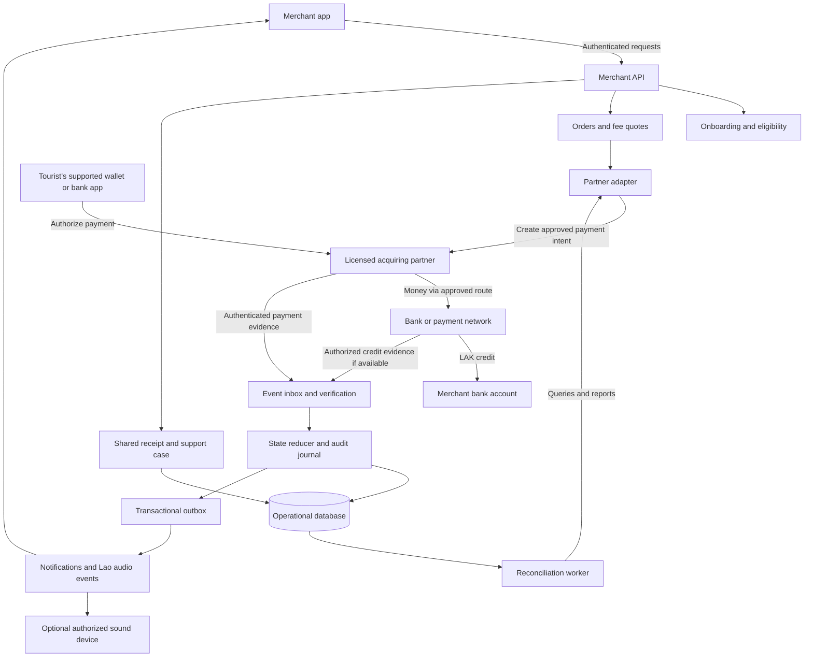

# Sabaidee Merchant — Technical Blueprint

**ຈຸດປະສົງ:** ແອັບຮັບເງິນ Cross-Border ສຳລັບຮ້ານ Street Food ແລະ Souvenir ໃນລາວ.

**Status:** Proposed architecture for an idea-only competition pitch. No live payment integration, regulatory approval, partner agreement, supplier quotation or pilot result is implied.

**Design baseline:** The team-approved [Lao HTML brief](output/html/sabaidee-merchant-brief.html) and decisions in the current conversation. [Open the interactive system flowchart](exports/system_flowchart.html).

## 1. Project inputs and file protocol

| File | Role | State at this revision |
|---|---|---|
| `00_CONTEXT.md` | Baseline goals and owner decisions | Not present when this revision was written; no contents assumed |
| `01_CODEX_ARCH.md` | Canonical technical blueprint, requirements and feature matrices | This document |
| `02_GEMINI_AUDIT.md` | Gemini AntiGravity findings | Not present; no audit results or approvals assumed |
| `exports/system_flowchart.html` | Standalone visual architecture and scenario explorer | Companion to this revision |

For future revisions, read `00_CONTEXT.md` and any available `02_GEMINI_AUDIT.md` before changing the design. Map each audit finding to its original ID, affected requirement, proposed response, evidence and disposition. Preserve the audit author's text. An audit recommendation does not silently override an explicit owner decision; record conflicts for resolution. Update the Version Log at the bottom of each document written.

This revision does not create substitute context or audit files. Its baseline remains provisional until those inputs are available.

## 2. Product decisions

### 2.1 Value proposition

> ລູກຄ້າຈ່າຍດ້ວຍແອັບທີ່ຄຸ້ນເຄີຍ; ແມ່ຄ້າຮູ້ຍອດຮັບສຸດທິ ແລະ ເວລາເງິນເຂົ້າ ຕັ້ງແຕ່ກ່ອນຮັບຈ່າຍ.

The first segment is small tourist-market vendors, with tourist purchases funded through supported existing wallets or bank apps. The product competes through understandable costs, a simple merchant experience, reliable status and local support.

### 2.2 Scope boundaries

- Own merchant-facing application and service experience; tourists use an existing supported payment application.
- A single merchant interface can present different partner-approved QR formats. One universally scannable QR is not assumed.
- PromptPay is a payment system: eligibility must name the participating bank app and supported merchant acceptance route.
- No additional tourist account or KYC inside our application for the familiar-wallet flow. Existing wallet verification, limits and transaction checks still apply.
- Merchant onboarding and cross-border activation require partner review, even for an existing bank customer.
- Funds, FX and bank credit are executed by appropriately authorized institutions. Our operational records do not represent a new customer wallet balance.
- The startup's own regulatory classification and approvals must be established. A bank relationship does not transfer the bank's license to the startup.
- Immediate availability is offered only for eligible, contractually supported routes or a separately approved partner-funded advance arrangement.

### 2.3 Delivery stages

| Stage | Deliverable | Required evidence |
|---|---|---|
| Current: pitch | Brief, visual architecture, mock screens, illustrative economics | Clearly label simulations and assumptions |
| Future: feasibility | Corridor-specific commercial and regulatory design | Partner scope, merchant eligibility, API access, fees, payout terms and relevant approvals |
| Future: sandbox | Non-production integration and failure scenarios | Partner documentation, test credentials and reproducible results |
| Future: controlled pilot | Proposed 30–50 vendors in one market | Approval to operate, contracts, trained support, controls and monitored results |

The current request authorizes documentation. This blueprint does not initiate implementation, merchant enrollment, outreach or real payments.

## 3. Proposed architecture

Start with one licensed acquiring partner and one supported corridor. Use a modular backend with separate background workers rather than assuming independently deployed microservices. Keep provider-specific contracts behind an adapter so later expansion does not change merchant-facing meanings.

Technology selection is deferred until partner SDK/API requirements, team capability, hosting obligations and device constraints are known.

The bank/network credit feed is a **capability requirement**, not a confirmed public API. If only payment acceptance evidence is available, the application cannot assert bank credit. Some routes may provide both types of evidence through the acquiring partner.

### 3.1 Responsibility matrix

| Participant/module | Responsibility | Boundary |
|---|---|---|
| Tourist wallet/bank | Customer authentication, payer checks and authorization | We do not collect its PIN, OTP or login credentials |
| Licensed acquiring partner | Merchant activation, supported acceptance, transaction processing, FX and agreed payout | Specific services and liabilities require contract confirmation |
| Bank/payment network | Transfer, clearing/settlement and account credit under its rules | Network connection alone does not guarantee availability or access |
| Merchant app | LAK price, approved QR display, cost/status view and audio | Cannot declare success from a customer screenshot |
| Onboarding module | Consent, application completeness and partner review status | Cannot approve beyond delegated authority |
| Orders/quotes module | Order identity, eligible route and versioned fee terms | Unknown fees remain unknown; no invented cheapest-route claim |
| Event verification | Authenticate provider evidence and match its transaction | Client-side success pages are not authoritative |
| State/reconciliation | Maintain separate payment, payout and refund states | Operational mirror, not the bank's accounting system |
| Support/receipts | Shared reference, investigation and refund workflow | A support agent cannot manually assert a bank credit |
| Market operator | Distribution, training and optional market services | No access to bank credentials or unrestricted individual merchant data |

## 4. Feature breakdown and acceptance criteria

**P0** = future core payment feasibility scope; **P1** = subsequent extension. Neither designation means implemented.

| ID | Feature | Priority | Proposed behavior | Acceptance condition / dependency |
|---|---|---|---|---|
| F01 | Familiar-wallet acceptance | P0 | Tourist uses an eligible existing app | Exact app, corridor, QR type and merchant category are approved and tested |
| F02 | Partner-issued QR | P0 | Price/order-specific QR where supported | Merchant, LAK amount, order reference and validity are matched; no self-invented cross-wallet format |
| F03 | Bank-assisted merchant onboarding | P0 | Reuse verified bank data with consent | Three-minute application target; activation only after partner approval |
| F04 | Cost and compatibility card | P0 | Show merchant fee, net LAK and payout terms | Versioned quote; clear expiry and rounding; unknown customer costs identified |
| F05 | Separate payment and credit status | P0 | Show acceptance independently from bank availability | Each state cites its evidence source and reference |
| F06 | Lao audio alerts | P0 | Distinct payment-confirmed and bank-credit phrases | Authenticated event, correct amount, no duplicate or stale success announcement |
| F07 | Low-connectivity handling | P0 | Cache display data; show disconnected/stale state | No offline success inference; resync and reconcile after reconnect |
| F08 | Shared receipt/support case | P0 | Tourist and merchant reference the same transaction | Access-limited receipt; no exposed bank details; support history retained |
| F09 | Refund and reconciliation | P0 | Authorized refund request and partner result tracking | Refund request does not mean refunded; daily exception resolution |
| F10 | Optional soundbox | P1 | Authorized device receives the same verified events | Pairing, revocation, connectivity, cost and duplicate behavior tested |
| F11 | Market Passport | P1 | Optional cross-store stamps and funded rewards | Confirmed eligible purchase; reverse stamp after refund; explicit reward budget |
| F12 | Market/Pro analytics | P1 | Reports and staff permissions | Merchant consent, tenant isolation and aggregation rules |

### 4.1 Competitive evidence carried forward

| Capability | LOCA PAY public description | NewPay public description | Design implication |
|---|---|---|---|
| Fee | 3% + 5,000 LAK per transaction [S1] | Method/merchant agreement-specific [S3] | Evaluate like-for-like total costs; our example rates are not quotes |
| Tourist flow | LOCA app with eligible cards/wallets [S1] | Supported existing wallets can pay [S2] | No-download is a baseline, not a unique invention |
| Voice notification | Not established by sources reviewed | Advertised [S2] | Compete on trustworthy states and local usability |
| Settlement | Route-specific verification needed | Agreement-specific; T+1/T+2 or other schedules described [S3] | Obtain corridor-specific payout terms |
| Proposed additions | Absence not established | Absence not established | Do not claim exclusivity without product/user validation |

Sources describe supplier offerings; this is not a hands-on competitor audit. Merchant distrust and difficult UX remain hypotheses unless supported by interviews or usability evidence.

## 5. End-to-end flows

### 5.1 Merchant onboarding

1. Merchant selects Lao language and verifies the contact channel.
2. Merchant authorizes partner-assisted account linkage through an approved bank process. We never ask the helper to collect bank OTP/PIN.
3. Capture missing merchant identity, operating information and any required permits.
4. Display terms, fee schedule, payout timing and consent scope.
5. Submit application with an idempotent reference; show `SUBMITTED`/`UNDER_REVIEW`.
6. Partner returns an approval, request for documents or rejection.
7. Activate only the approved merchant account, corridors and products. Changes to the receiving bank account require re-verification.

Suggested application-time budget: 0–30 seconds contact; 30–90 seconds consent/linking; 90–150 seconds business details; 150–180 seconds terms/submission. This is a usability target, not a measured result. Existing bank KYC does not automatically establish merchant KYB or cross-border eligibility.

### 5.2 Payment

1. Merchant creates an order with `merchant_id`, `order_id`, LAK amount and a client-generated idempotency key.
2. Backend checks approval, staff permission, route eligibility and a valid fee quote. A quote includes known fee, expected net LAK, timing policy and expiry.
3. Adapter creates a partner payment intent once. Persist the external reference before exposing the resulting QR. If the request times out, recover by the original reference before creating another intent.
4. Merchant displays the correct approved QR. Tourist checks merchant identity and final payer amount in the existing wallet and authorizes there.
5. Backend receives and verifies provider evidence. Match provider account, merchant, order/intent, currency, amount and status.
6. Commit normalized event, state change and notification outbox atomically.
7. Merchant app receives the event and may announce payment confirmation according to the route's agreed acceptance semantics.
8. Separate authorized evidence establishes account credit and the actual credited amount. Only then show/announce bank credit.
9. Generate an access-limited shared receipt. Reconcile financial records and resolve any mismatch.

Goods release follows the agreed merchant acceptance policy. Neither a pending result nor a customer's screenshot authorizes the application to mark payment confirmed.

### 5.3 Static QR fallback

A partner-approved printed QR can remain visible when the merchant phone is disconnected, if the payer and payment infrastructure are online. It does not itself provide offline verification.

If a static-QR transaction lacks an order reference, it may appear as an unmatched receipt. Same amount plus nearby time is not sufficient to automatically link it to a sale. Keep it unmatched until reliable provider evidence or a controlled reconciliation process resolves the association.

### 5.4 Refund

1. Authorized merchant requests a full/partial refund by original transaction reference.
2. Validate refundable amount, permissions and current state; create a unique refund reference.
3. Partner processes the request. A timeout triggers a query using that reference, not a second refund request with a new identity.
4. Show `REQUESTED` or `PROCESSING` until an authoritative result arrives.
5. On confirmed completion, update refunded amount and receipt. Retain the original payment and payout history; reverse relevant loyalty rewards.
6. Explain that the original funding source's return timing and FX treatment depend on its rules.

## 6. State model and evidence

Keep independent dimensions. `OFFLINE` belongs to device connectivity, not the payment's financial outcome.

| Dimension | Proposed values | Authority |
|---|---|---|
| Merchant | `DRAFT`, `SUBMITTED`, `UNDER_REVIEW`, `APPROVED`, `RESTRICTED`, `REJECTED` | Partner approval plus our access restrictions |
| Payment | `CREATED`, `AWAITING_CUSTOMER`, `PENDING`, `PROVIDER_CONFIRMED`, `FAILED`, `EXPIRED` | Partner result/query, normalized under its documented semantics |
| Bank credit | `NOT_CONFIRMED`, `PENDING`, `CREDITED`, `EXCEPTION` | Authorized receiving-bank/partner credit evidence |
| Refund | `NONE`, `REQUESTED`, `PROCESSING`, `PARTIALLY_REFUNDED`, `REFUNDED`, `FAILED` | Partner refund evidence |
| Device | `ONLINE`, `DISCONNECTED`, `SYNCING` | Device connection/freshness |

`PROVIDER_CONFIRMED` is an application-level acceptance state, not a general legal claim of irrevocable payment finality. Disputes and later adjustments remain separate records.

### 6.1 Transition rules

- Payment confirmation requires authenticated, matched evidence; no UI button or support override can manufacture it.
- QR expiry closes the initiation window. It does not erase a debit already in progress. Late provider confirmation after displayed expiry must be reconciled and surfaced, not discarded.
- A transport timeout leaves an unknown/pending outcome. Mark `FAILED` only with evidence that establishes failure under the partner contract.
- Out-of-order events must not move a confirmed payment back to pending. A later reversal is a separate adjustment/dispute event.
- A credit event that arrives before acceptance evidence remains linked but triggers reconciliation. Do not discard evidence because delivery order differs.
- Partial/mismatched credit becomes `EXCEPTION`; do not announce the expected net amount as fully received.
- Refund processing never overwrites the historical credit event. Present both the original credit and refund status.

### 6.2 Lao audio policy

| Evidence | Merchant display | Example phrase | Audio rule |
|---|---|---|---|
| Matched provider acceptance | Payment confirmed; credit pending | “ການຈ່າຍ 50,000 ກີບ ສຳເລັດແລ້ວ” | Only if the route's acceptance semantics permit it |
| Matched bank credit of 49,750 LAK | Credited | “ເງິນສຸດທິ 49,750 ກີບ ເຂົ້າບັນຊີແລ້ວ” | Amount must come from actual credit evidence |
| Pending/unknown | Waiting for confirmation | No success phrase | Provide status/support guidance |
| Disconnected merchant | Status unavailable/stale | No new success phrase | Resync; never infer outcome |
| Duplicate/stale notification | Existing history | No repeated live success phrase | Dedupe by device + event + semantic type |

Notification delivery is at-least-once with client deduplication. True exactly-once audible output across crashes cannot be assumed; after an ambiguous interrupted playback, show history and require deliberate replay rather than automatically announcing an old payment as new.

## 7. Data and integration contracts

All names below are proposed internal contracts. They are not BCEL, LAPNet or wallet API documentation.

### 7.1 Minimum records

| Record | Minimum fields / purpose |
|---|---|
| `Merchant` | Internal/partner ID, review status, enabled products, verified receiving-account reference, consent version |
| `StaffDevice` | Merchant, role, device ID, paired-device status and revocation |
| `FeeQuote` | Quote ID, route, currency/amount, fee components, rounding policy, expected net, payout terms, expiry, terms version |
| `Order` | Merchant/order ID, LAK amount, quote ID, payment state, timestamps and version |
| `PaymentIntent` | Partner, external reference, original idempotency key, approved QR payload/reference and expiry |
| `ProviderEvent` | Partner/event ID, authenticated evidence reference, raw/normalized statuses, match result and received time |
| `BankCredit` | Bank/partner credit reference, account reference, actual amount/currency, linked payment and reconciliation state |
| `Refund` | Original transaction, unique refund reference, amount, state and evidence |
| `ReceiptSupportCase` | Access-limited receipt token, transaction reference, request history and authorized participants |
| `OutboxDelivery` | Event/semantic type, recipient, delivery/retry status and dedupe key |
| `AuditEntry` | Actor/service, action, evidence reference, time and relevant state version |

Use integer minor units with currency metadata or an exact decimal representation; never binary floating-point money. Contract the LAK precision and rounding policy with the partner. Maintain requested, fee, expected net and actually credited values separately.

Operational accounting mirrors partner transactions for reconciliation. Company subscription income, partner fees, merchant receivables and any partner-funded advances have distinct records; none is represented as customer deposit funds held by the startup.

### 7.2 Proposed internal operations

| Operation | Requirements |
|---|---|
| `POST /merchant-applications` | Authenticated applicant, explicit consent and idempotency |
| `GET /payment-capabilities` | Merchant-specific approved methods and eligibility |
| `POST /fee-quotes` | Versioned fees, expiry and known/unknown customer cost fields |
| `POST /orders` | Staff permission, idempotency, quote/amount consistency |
| `GET /orders/{id}` | Tenant isolation; evidence-backed multidimensional status |
| `POST /provider-events/{partner}` | Partner-specific authentication, replay controls, durable inbox and dedupe |
| `POST /orders/{id}/refunds` | Refund role, unique identity and refundable-amount checks |
| `GET /receipts/{token}` | Unpredictable, scoped, revocable access; no bank credentials/full account details |

### 7.3 Event ingestion sequence

1. Authenticate the request using the partner's prescribed signature/certificate/channel controls; validate replay rules.
2. Durably record the original evidence. Acknowledge only after durable receipt according to the partner contract.
3. Dedupe by partner and stable event identity; also enforce business-level uniqueness on the external transaction/reference.
4. Normalize status and match merchant, order, currency, amount and external reference.
5. Quarantine invalid, unmatched or conflicting evidence. Do not create success notifications for it.
6. Commit valid state transitions and outbox events in one database transaction.
7. Deliver notifications; retry with backoff and client dedupe. Route persistent delivery failures to an operations queue.
8. Query/reconcile stale transactions through the original partner reference. Keep unresolved cases visible.

No global callback signature algorithm, timeout, transaction limit or fee rate is invented in advance of partner documentation.

## 8. Partner dependencies and regulatory questions

BCEL is the first proposed institution to approach, based on its existing cross-border role [S5]. No agreement or integration access has been confirmed.

| ID | Must establish before claiming feasibility | Evidence needed |
|---|---|---|
| D01 | Startup's permitted role and approval obligations | Written regulatory/legal classification and applicable approvals |
| D02 | Partner's scope for selected cross-border products | Current license/product authorization and contracts |
| D03 | Exact tourist apps, merchant categories and QR types | Capability matrix and certification/test evidence |
| D04 | Merchant onboarding/data reuse | Required documents, consent rules, review authority and data-sharing terms |
| D05 | Price economics | Full corridor-specific fee/FX/fixed-cost quotation and taxes where applicable |
| D06 | Payment and bank-credit visibility | Documented status semantics, callbacks, queries and credit/report access |
| D07 | Availability/SLA | Measured or contracted payout timing, holidays, limits and exceptions |
| D08 | Accelerated payout option | Authorized funder, capital source, eligibility, price, loss allocation and recourse |
| D09 | Refunds/disputes | Supported refund types, timing, FX treatment and chargeback allocation |
| D10 | Data/operations | Hosting, access, retention, incident reporting and support responsibilities |

BOL Notice No. 05 and the amended Payment System Law inform the design, but this document does not establish legal approval. The original notice and the BOL-hosted English translation were reviewed in the preceding research; the translation is labeled unofficial [S6][S7]. Technical non-custody does not establish an exemption from approval requirements.

## 9. Economics and payout design

### 9.1 Revenue model

Basic merchant acceptance has no proposed app subscription; route-specific payment charges remain transparent. Revenue may come from an agreed acquiring/service margin, optional Pro tools and a market-operator package. Do not count a partner revenue share twice if already included in the transaction margin.

Soundbox purchase/rental is optional. Market rewards and introductory subsidies require named funding, a budget cap and an end condition. Any platform FX markup must be explicit and permitted; it is not assumed in the base case.

### 9.2 Illustrative transaction economics

For a 50,000 LAK purchase: merchant fee at 0.5% = 250; partner cost at 0.3% = 150; fixed processing allocation = 30; operating/risk allocation = 40; contribution = **30 LAK** before central expenses and tax.

If partner cost is 0.6%, contribution becomes **−120 LAK**. These are illustrative assumptions, not supplier prices. Payout funding cost, SMS/device costs, fraud losses, support and regulatory overhead must be included as applicable.

LOCA's published 3% + 5,000 LAK charge is a benchmark for the described customer service [S1], not proof that our merchant fee covers an equivalent all-in tourist payment service. Compare both payer and merchant charges, FX, availability and settlement terms on the same corridor.

### 9.3 Accelerated payout

Preferred first route: direct bank credit under a supported partner product. A separate future option is partner-funded advance payout for eligible transactions. It requires an approved provider/funder, sufficient liquidity, limits, monitoring and a contract covering reversals and losses.

Illustration: 10 million LAK of eligible advances daily × 2 days awaiting funds = **20 million LAK** base working capital, before holiday, concentration, fraud and refund buffers. The startup cannot promise this capability merely by displaying an instant status or joining a network.

## 10. Failure coverage matrix

| Failure / weakness | Required behavior | Residual dependency |
|---|---|---|
| Unsupported tourist app | Check capabilities before intent; explain approved alternatives | Partner coverage |
| Quote expires or price changes | Obtain new quote/intent before customer authorization | Provider quote semantics |
| Create-intent request times out | Query by original reference before retry; preserve same operation identity | Partner idempotency/query support |
| Customer may be debited; result unknown | Show pending; prevent automatic new payment or route switch | Provider investigation/reconciliation |
| Duplicate callback | Persist/dedupe; no second state effect or live audio | Stable identifiers and client dedupe |
| Callback forged or mismatched | Reject/quarantine; no success state | Partner authentication and key management |
| Callback arrives late/out of order | Preserve evidence; apply valid forward transition or adjustment | Documented status semantics |
| Merchant phone offline | Show stale/disconnected; recover events after reconnect | Device/network availability |
| Both sides offline | No newly verified success | Connectivity; no universal offline promise |
| Static QR without order reference | Keep receipt unmatched until reliable association | Partner references/manual reconciliation |
| Payment confirmed; credit delayed | Display both states and expected payout timing | Bank credit visibility and SLA |
| Credited amount differs from expected | Exception; show actual evidence and investigate fee/credit mismatch | Bank/partner reconciliation |
| Refund request times out | Query same refund reference; avoid duplicate refund | Provider refund support |
| Device reconnects with old events | Update history; suppress stale live-success audio | Freshness/playback rules |
| Soundbox lost or spoofed pairing | Revoke device; re-pair with merchant authorization | Device security and network |
| Costs exceed proposed fee | Reprice/disable unviable offer before sale; no silent subsidy | Commercial quotation |
| Prefunding exhausted | Suspend accelerated payout promise; display actual timing before new payment | Funder liquidity/approved contingency |
| Merchant eligibility changes | Restrict new acceptance; retain access to records/support | Partner compliance decisions |

## 11. Security, reliability and validation plan

### 11.1 Controls to specify with the partner

- Tenant isolation and role-based access: owner, cashier, support and market administrator have distinct scopes.
- Step-up verification and review for receiving-account changes and privileged actions.
- Encrypted transport/storage, managed secrets, credential rotation and minimal personal data.
- Scoped, revocable receipts; no sensitive transaction data in public analytics or logs.
- Durable inbox/outbox, database constraints and audited state changes.
- Reconciliation reports for stale pending, unmatched events, credit differences and refund exceptions.
- Backup/restore, incident response, key compromise response and partner escalation procedures.
- Monitoring that distinguishes financial failure, unknown outcome and notification delay.

Service latency, availability, retention and transaction limits remain **TBD by contract and measured tests**. Do not present invented targets as achieved performance.

### 11.2 Meaningful future integration checks

| Check | What it proves |
|---|---|
| Eligible app → approved merchant QR | Real corridor compatibility, not a logo claim |
| Provider confirmation → separate account credit | Correct financial-state meanings |
| Duplicate, reordered and replayed callbacks | Stable state and controlled notification effects |
| Debit with timeout/late success | No accidental duplicate charge or false failure |
| Offline merchant → reconnect | Honest stale state and correct recovery |
| Fee quote versus actual deductions | Real merchant net and total cost correctness |
| Partial credit/refund/dispute | Exceptions do not overwrite original transaction history |
| Tenant/device/role access attempts | Account data and refund permissions remain isolated |
| Restore and reconciliation after interruption | Recovery preserves event identity and financial evidence |

The companion HTML tests only presentation behavior and scenario calculations. It cannot validate bank connectivity, settlement speed, soundbox delivery or regulatory compliance.

## 12. Pitch and audit handoff

| Pitch claim | Defensible wording now | Evidence needed for stronger wording |
|---|---|---|
| No tourist download | Designed for existing supported wallets/bank apps | Exact route/app integration |
| Three-minute onboarding | Target for submitting a complete application | Measured user test; approval still separate |
| Low fees | Corridor-specific target, with transparent cost model | Supplier quotes and sustainable economics |
| Instant LAK | Proposed for eligible partner-supported routes | Contract plus measured credit evidence |
| Audio confirmation | Proposed verified Lao alerts | Device tests and provider evidence integration |
| Better than both competitors | Focused hypothesis for small market purchases | Like-for-like comparison and user evidence |

Pending inputs: `00_CONTEXT.md`, `02_GEMINI_AUDIT.md`, partner capability/price documents and any team research. When an audit arrives, add its finding dispositions here and revise the HTML in the same revision where affected behavior changes.

## 13. Sources and provenance

Research provenance is carried forward from the team brief prepared on 2026-10-11; this architecture revision does not claim a new supplier verification or hands-on competitor test.

- [S1 — LOCA PAY product and published fee](https://loca.la/locapay/)
- [S2 — NewPay merchant services](https://newpay.la/en/merchant.html)
- [S3 — NewPay FAQ: fees, onboarding, settlement and refunds](https://newpay.la/en/faq.html)
- [S4 — LAPNet payment network](https://www.lapnet.com.la/)
- [S5 — BOT–BOL Thai–Lao QR linkage announcement, 2024](https://www.bot.or.th/en/news-and-media/news/news-20240403.html)
- [S6 — BOL Notice No. 05, 4 January 2024, original PDF](https://www.bol.gov.la/fileupload/08-01-2024_1704679490.pdf)
- [S7 — BOL-hosted English translation of amended Payment System Law](https://www.bol.gov.la/en/fileupload/18-12-2025_1766051569.pdf)
- [S8 — LOCA user KYC process](https://loca.la/blog/locapay-introduces-a-simple-kyc-process-for-secure-payments/)

# Version Log

| Timestamp | Version | Author | Change |
|---|---|---|---|
| 2026-10-11 23:52:27 +07:00 (Asia/Bangkok) | 0.1 | Codex | Created provisional architecture and matrices from the accepted brief; recorded missing context/audit inputs, partner dependencies, financial-state rules and future validation plan. Companion: `exports/system_flowchart.html`. |
| 2026-10-12 00:03:27 +07:00 (Asia/Bangkok) | 0.1 | Codex | Finalized companion visual; verified six interactive scenarios, calculator validation, responsive layouts at 320/390/768/1440 px, embedded Lao font and zero external requests or script errors. These are document checks, not payment-integration tests. |
